# Background depth and glass cards

Captured from local production builds in Chrome at device scale factor 1. Before is main at `3f73081`. The card detail is the Reconciliation capability card.

| Width | Area | Before | After |
| --- | --- | --- | --- |
| 375 px | hero | 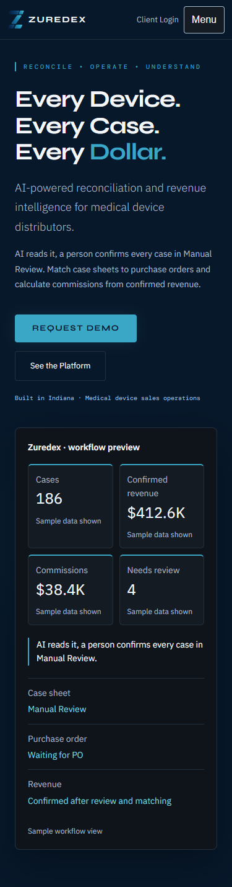 | 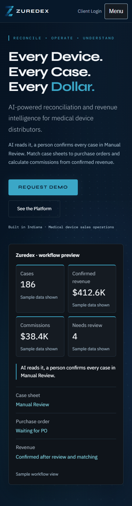 |
| 375 px | platform | 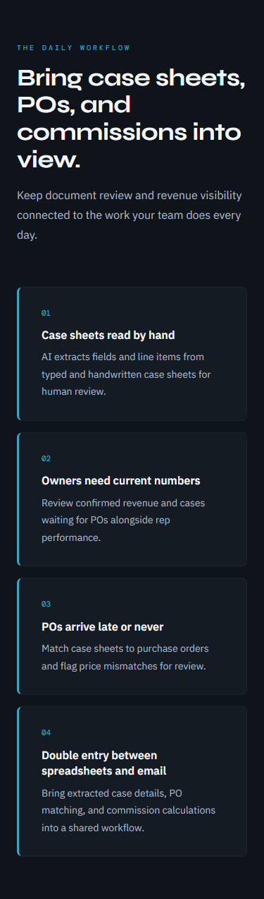 | 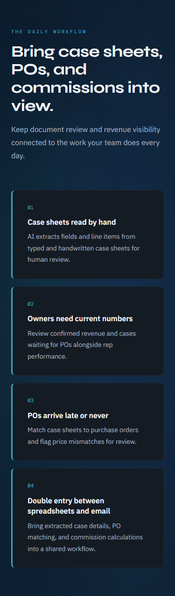 |
| 375 px | card | 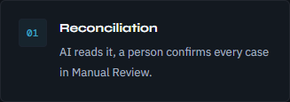 | 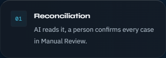 |
| 1280 px | hero | 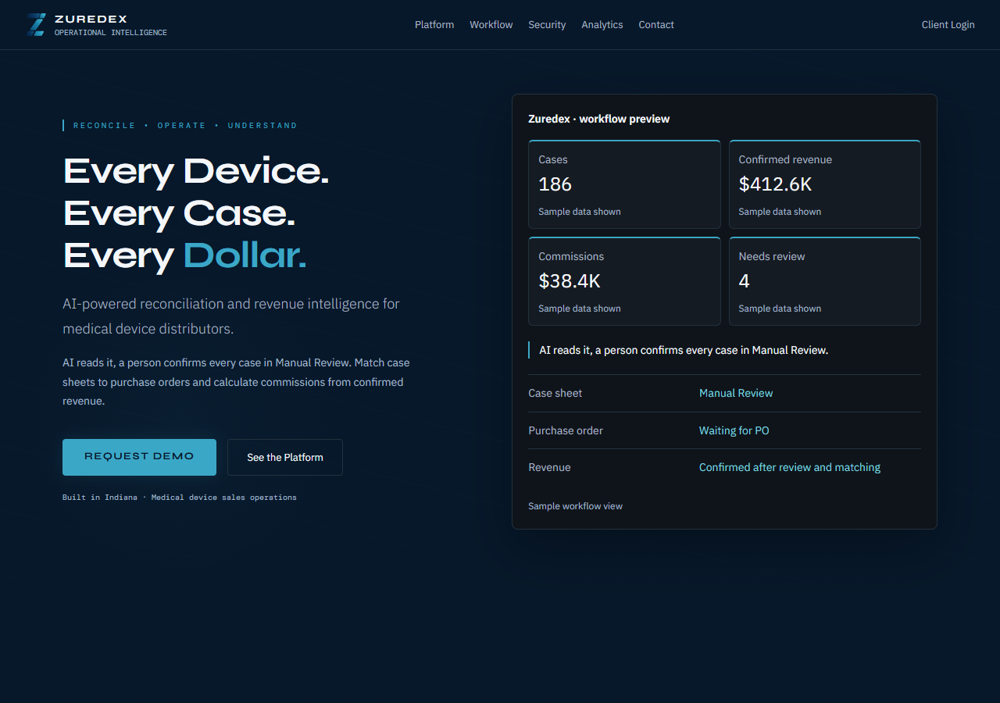 | 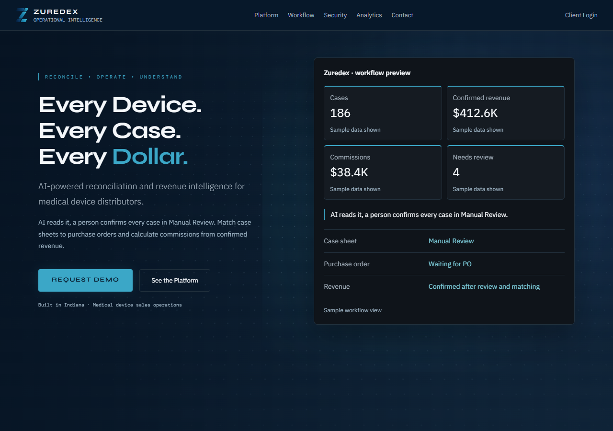 |
| 1280 px | platform | 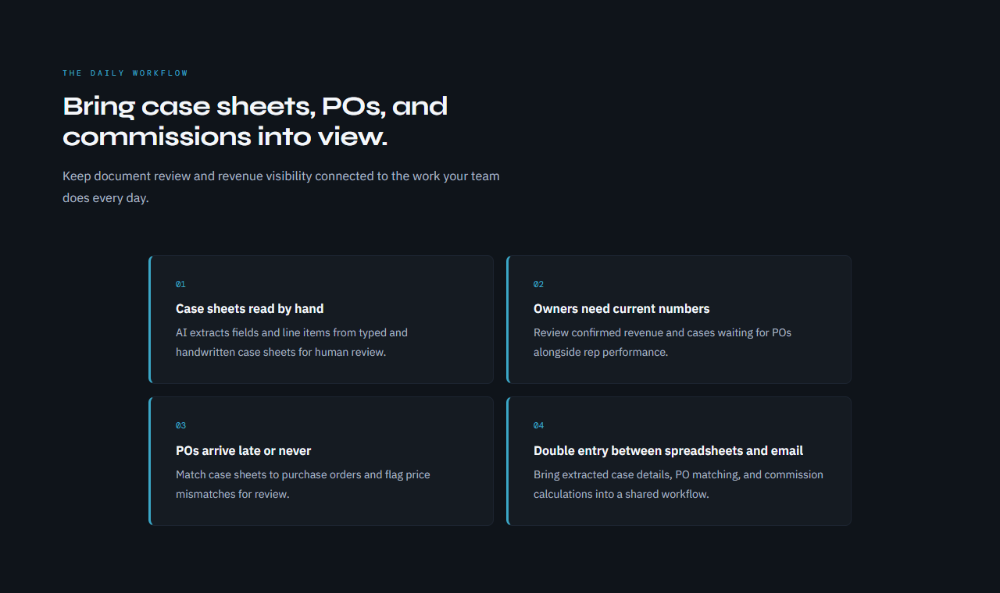 | 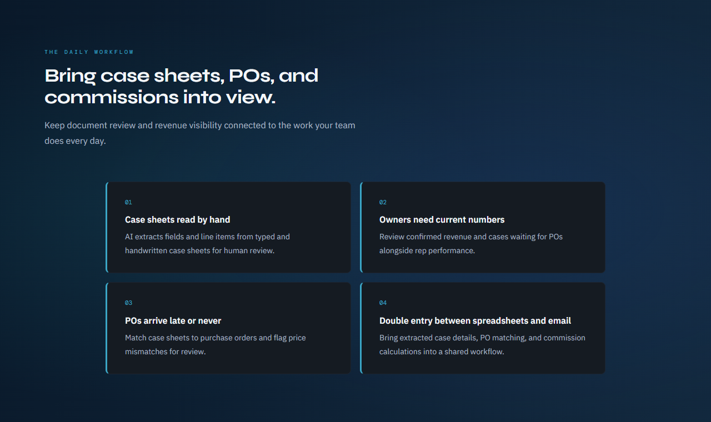 |
| 1280 px | card | 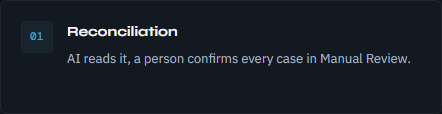 | 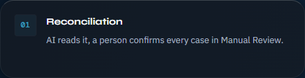 |

The main content uses a continuous navy gradient. The perspective dots and radial glows are static CSS. All five glass-card families share the top border and radius: Home capabilities, Home analytics metrics, Home security/governance, About leadership, and About engineering/security. Platform's opaque daily-workflow cards retain their teal left edge.

| Local homepage benchmark | Before | After |
| --- | ---: | ---: |
| Mobile Lighthouse performance / accessibility / best practices / SEO | 100 / 100 / 100 / 100 | 100 / 100 / 100 / 100 |
| Desktop Lighthouse performance / accessibility / best practices / SEO | 100 / 100 / 100 / 100 | 100 / 100 / 100 / 100 |
| Mobile / desktop LCP | 0.9 s / 0.3 s | 0.9 s / 0.3 s |
| Emitted JS chunks, bytes (gzip) | 671,711 (202,589) | 671,711 (202,589) |
| Emitted CSS chunks, bytes (gzip) | 17,292 (3,414) | 17,292 (3,414) |
| Shared inline stylesheet, bytes (gzip) | 9,766 (2,442) | 11,573 (2,911) |

Lighthouse 13.6.0, one simulated navigation per version and device preset. Chunk sizes sum the files in the production static chunks directory, compressing each separately. The inline stylesheet is measured separately with LF line endings and gzip, outside those chunks.

The minimum measured hero text contrast was **5.86:1 at 375 px** and **5.32:1 at 1280 px**. The check compared computed foreground colors to rendered background pixels beneath the hero text rectangles. Chrome confirmed the shared glass-card styles on Home and About, no horizontal overflow at either width, and identical visible page text on Home, About, Privacy and Terms. Lint, TypeScript and production build passed.
